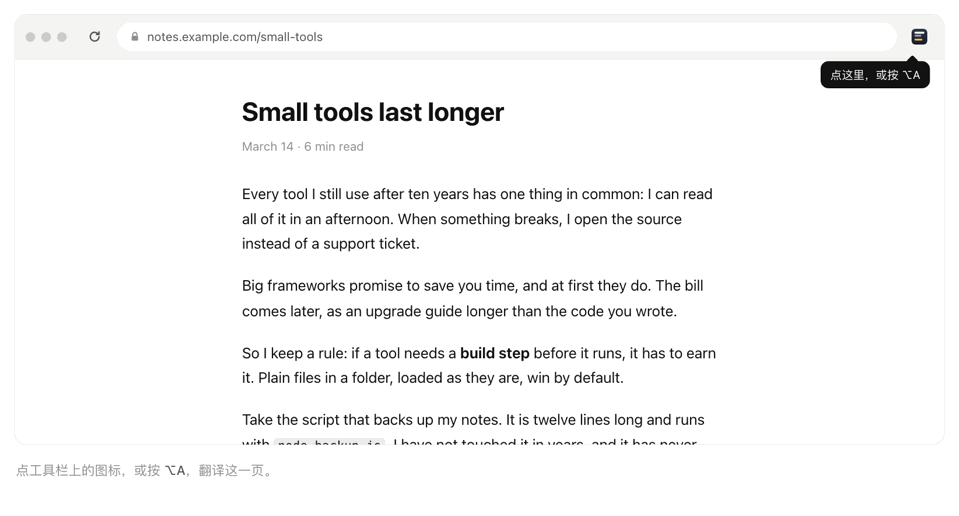

# 简单翻译 Plain Translate

简单翻译是一个开源、极简的 Chrome 扩展，只做一件事：用你自己的大模型翻译正在读的网页，把译文放在每段原文下面。

动图录自 [max1874.com/simple-translate](https://max1874.com/simple-translate/)，那里可以亲手试。

- **一键开关**：点工具栏上的简单翻译图标，或按 <kbd>⌥A</kbd>（Windows/Linux 上是 <kbd>Alt</kbd>+<kbd>A</kbd>）开始翻译；再按一次，页面恢复原样。
- **只翻你在看的**：屏幕上的段落先翻，往下滚再继续；每段翻完立刻显示，不等整批。
- **用你自己的模型和 key**：OpenRouter、OpenAI、DeepSeek、Ollama，或任何兼容 OpenAI 接口的服务。
- **你不点，它就不动**：不在每个网页常驻脚本，不要「读取所有网站」的权限，没有统计上报，没有我们自己的服务器。网页文字只发给你选的那个服务。
- **小**：纯 JavaScript，没有依赖，不用构建。

## 安装

从 [Chrome 网上应用店](https://chromewebstore.google.com/detail/plain-translate/agbnnlocgcdpnkkbfooojejhnpcemiko)安装。第一次点工具栏上的简单翻译图标会打开设置页。

想用这个仓库里最新的代码：clone 下来，打开 `chrome://extensions`，打开右上角的「开发者模式」，点「加载已解压的扩展程序」，选仓库文件夹。它和应用店版是两个扩展，设置不互通。

## 设置

1. **选一个翻译服务**。选中后地址和推荐模型会自动填好。点选服务或点「测试」时，Chrome 会弹窗问能否「读取和更改你在 openrouter.ai 上的数据」：这是 Chrome 对网站访问权限的统一说法，扩展只用它向这个地址发送翻译请求。点允许。
2. **粘贴 API Key**。旁边的「获取 API Key」会打开服务商创建 key 的页面。每个服务的 key 分开保存，切换服务不会丢。
3. **模型**可以直接输入，也可以从服务商返回的模型列表里搜索选择。
4. **推理**建议保持「关闭」。翻译很少需要推理，开着只会更慢：DeepSeek V4.1 Flash 默认会推理，第一个字要等约 8 秒，关闭后约 2 秒（2026-10-13 在 OpenRouter 上实测）。不是每个模型都支持每一档，不支持时服务商的报错会显示在测试结果里。
5. 点 **测试**，会显示首字和完成用时，以及一句示例译文。
6. **翻译成**：选你要读的语言。翻译是单向的：原文是什么语言都会翻成这一种，已经是这种语言的段落自动跳过。

## 使用

打开任意网页，点工具栏图标或按快捷键。Chrome 只在安装扩展时、且这个组合键没被占用时才分配快捷键，被占用也不提示。设置页里快捷键显示「未设置」，多半是别的扩展占着 <kbd>⌥A</kbd>（沉浸式翻译默认就用它）：先在 `chrome://extensions/shortcuts` 里清掉那个扩展的 <kbd>⌥A</kbd>，再给简单翻译设上；设置页的「修改」直接打开这个页面。

`chrome://` 页面和 Chrome 网上应用店的页面不允许扩展运行，在那里点图标不会有反应。

## 常见问题

**和沉浸式翻译、Chrome 自带的翻译有什么区别？**
Chrome 自带翻译用谷歌翻译把原文替换掉；简单翻译保留原文，译文放在下面，用你选的模型。沉浸式翻译同样是双语对照，还做 PDF、视频字幕等很多别的事；简单翻译只翻网页，没有账号，没有我们自己的服务器。

**网页文字会发到哪里？**
只在你打开翻译后，把要翻的段落发到你设置的那个服务地址。不发网址，不发给我们，也没有统计。

**能用哪些模型？要花钱吗？**
任何兼容 OpenAI `/chat/completions` 接口的模型：OpenRouter、OpenAI、DeepSeek、本地 Ollama，或自定义地址。扩展免费（MIT），费用由你选的服务商按它的价格收；本地 Ollama 不用 key。

**Chrome 网上应用店里能装吗？**
能，[在这里](https://chromewebstore.google.com/detail/plain-translate/agbnnlocgcdpnkkbfooojejhnpcemiko)。它在应用店里的英文名是 Plain Translate；应用店里叫 Simple Translate 的是另一个扩展。

更多说明见 <https://max1874.com/simple-translate/>。

## 工作原理

- 点击时，`background.js` 把 `content.js` 注入当前标签页（靠 `activeTab`，所以不需要所有网站的权限），翻译请求从后台发到 `{地址}/chat/completions`，流式接收。
- `content.js` 按块级元素和 ` ` 把页面切成段落，跳过代码、导航、表单控件和已经是目标语言的段落，在每段后面插入一个 ``。
- 段落里的链接、加粗、斜体等格式以 `<x1>…</x1>` 编号标签发给模型，行内代码、按键和图片以 `<x2/>` 占位、原样复制；译文按这些标签重建，所以保留原文的样式。和原文完全相同的译文（人名、标题）不显示。
- 段落以 JSON 对象（`{"1": "...", "2": "..."}`）分批发给模型，屏幕上的每批 4 段、其余每批 8 段，返回同样的 key。回复缺 key，或者看起来错位了（某段译文里出现了另一段的格式标签——同一批的标签连续编号；两个 key 译文相同；某个 key 里是另一段的原文；某段的「译文长度 ÷ 原文长度」和同批其他段差得太多），整批丢弃，改成逐段重翻。只有通过检查的译文才进缓存。
- 翻译开着的时候，后来加载的内容（无限滚动、单页应用改字、展开的折叠面板）也会补翻。

## 隐私

设置（包括 API Key）保存在这个浏览器的 `chrome.storage.local` 里，网页本身读不到 key。网页文字只在你打开翻译后、只发给你设置的服务地址。扩展不发起其他任何网络请求。

## 已知限制

- 只翻顶层页面，不翻 iframe 里的内容。
- flex 或 grid 布局里直接放着的短文字（多是按钮和菜单）不翻，因为译文插进去会排到原文旁边。
- Wikipedia 的标题会把「[edit]」一起翻成「编辑」。
- 屏幕上的段落每批只有 4 段，错位检查能用的样本少，主要靠「译文相同」和「某段是另一段原文」两项；批次小本身也让错位更少见。

## English

Plain Translate (简单翻译) is an open-source, minimal Chrome extension that translates the page you are reading with your own LLM and shows each translation below its paragraph. Click the toolbar icon or press <kbd>Alt</kbd>+<kbd>A</kbd> (<kbd>⌥A</kbd> on macOS); press again to restore the page. Pick a service in the settings (OpenRouter, OpenAI, DeepSeek, Ollama, or any OpenAI-compatible endpoint), paste your key, and keep **Reasoning** off for speed. Nothing runs until you click, there is no `<all_urls>` permission and no analytics, and page text goes only to the service you chose.

### FAQ

**How is it different from Immersive Translate or Chrome's built-in translation?**
Chrome's built-in translation replaces the page text using Google Translate; Plain Translate keeps the original and puts the translation below it, using the model you choose. Immersive Translate is also bilingual and does much more (PDFs, video subtitles); Plain Translate only translates web pages, with no account and no server of ours.

**Where does the page text go?**
Only after you turn translation on, the paragraphs being translated go to the one service address you set. The page URL is not sent, nothing comes to us, and there are no analytics.

**Which models work, and what does it cost?**
Any model behind an OpenAI-compatible `/chat/completions` endpoint: OpenRouter, OpenAI, DeepSeek, a local Ollama, or a custom address. The extension is free (MIT); the service you pick bills you at its rates, and a local Ollama needs no key.

**Is it on the Chrome Web Store?**
Yes: [Plain Translate on the Chrome Web Store](https://chromewebstore.google.com/detail/plain-translate/agbnnlocgcdpnkkbfooojejhnpcemiko). To run the latest code from this repository instead, load it unpacked as described under 安装 above; the two installs do not share settings. The Simple Translate listed on the store is a different extension.

More at <https://max1874.com/simple-translate/>.

## License

[MIT](LICENSE)。设置页里各服务的图标来自 [lobe-icons](https://github.com/lobehub/lobe-icons)（MIT），图标本身归各公司所有。
